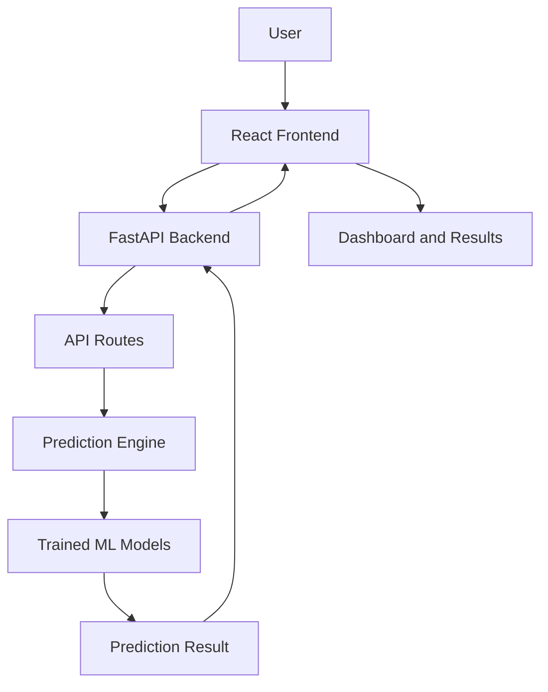
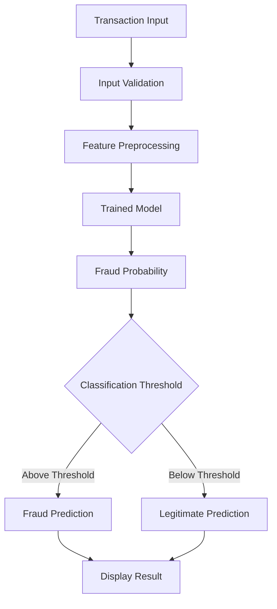

# 🛡️ FraudShield AI
### Intelligent Credit Card Fraud Detection Using Machine Learning

<p align="center">
  <strong>Detect suspicious transactions. Reduce financial risk. Make smarter decisions.</strong>
</p>

<p align="center">
  
  
  
  
  
</p>

<p align="center">
  <a href="#overview">Overview</a> •
  <a href="#features">Features</a> •
  <a href="#dataset">Dataset</a> •
  <a href="#methodology">Methodology</a> •
  <a href="#results">Results</a> •
  <a href="#installation">Installation</a>
</p>

---

<a id="overview"></a>
## 1. 📖 Project Overview

**FraudShield AI** is a machine-learning-based credit card fraud detection system designed to identify potentially fraudulent financial transactions.

Credit card fraud is a significant challenge for financial institutions because fraudulent transactions are extremely rare compared with legitimate transactions. Traditional classification models can struggle with this imbalance, sometimes achieving high accuracy while failing to detect actual fraud.

FraudShield AI addresses this problem using four classical machine learning algorithms:

- Decision Tree
- Random Forest
- XGBoost
- LightGBM

The project includes a complete web application with a React frontend and FastAPI backend. Users can examine dataset statistics, compare model performance, submit individual transactions for prediction, and upload CSV files for batch predictions.

The main objective is not simply to maximize accuracy, but to evaluate how effectively each model identifies fraudulent transactions while controlling false alarms.

**Project Category:** Machine Learning / Artificial Intelligence  
**Application Domain:** Financial Fraud Detection  
**Approach:** Supervised Binary Classification  
**Implementation:** Python, React and FastAPI

---

<a id="problem-statement"></a>
## 2. 🎯 Problem Statement

Credit card transaction datasets are highly imbalanced. The majority of transactions are legitimate, while only a very small percentage are fraudulent.

A model that predicts every transaction as legitimate may achieve approximately 99.83% accuracy on the original dataset while detecting zero fraudulent transactions.

This makes accuracy alone an unreliable evaluation metric.

The problem addressed by this project is:

> To develop and evaluate a machine learning system that can identify fraudulent credit card transactions from highly imbalanced transaction data while maintaining a suitable balance between precision and recall.

---

<a id="project-objectives"></a>
## 3. 🎯 Project Objectives

- Analyze credit card transaction data.
- Understand the impact of class imbalance.
- Perform data cleaning and preprocessing.
- Implement multiple classical machine learning algorithms.
- Apply class imbalance handling techniques.
- Prevent data leakage during model training.
- Compare models using appropriate classification metrics.
- Select a model using validation PR-AUC.
- Develop an interactive fraud detection web application.
- Support both individual and batch transaction predictions.

---

<a id="features"></a>
## 4. ✨ Key Features

### Machine Learning Features

- Four classical ML classification algorithms.
- Imbalanced dataset handling.
- Stratified training, validation and testing.
- StandardScaler preprocessing.
- Validation-based model selection.
- Adjustable classification threshold during evaluation.
- Precision, recall, F1-score, ROC-AUC and PR-AUC evaluation.

### Web Application Features

- Interactive dark-themed financial dashboard.
- Single transaction fraud prediction.
- Batch CSV transaction prediction.
- Dataset exploration and statistics.
- Model comparison dashboard.
- Confusion matrix visualization.
- Model evaluation and performance metrics.
- Machine learning algorithm explanations.
- Educational viva preparation section.

---

<a id="technology-stack"></a>
## 5. 🛠️ Technology Stack

| Category | Technologies |
|---|---|
| Programming Language | Python |
| Frontend | React, Vite |
| Styling | Tailwind CSS |
| Backend | FastAPI |
| API Server | Uvicorn |
| Machine Learning | Scikit-learn |
| Boosting Algorithms | XGBoost, LightGBM |
| Data Processing | Pandas, NumPy |
| Visualization | Recharts |
| Validation | Pydantic |
| Model Storage | Joblib |
| Development Environment | VS Code |
| Version Control | Git and GitHub |

---

<a id="system-architecture"></a>
## 6. 🏗️ System Architecture

FraudShield AI follows a frontend-backend-machine-learning architecture.



### Architecture Components

**1. Frontend Layer**

The React application provides the user interface for transaction input, dataset exploration, dashboards and prediction results.

**2. Backend Layer**

FastAPI manages HTTP requests, validates incoming data and communicates with the machine learning prediction modules.

**3. Machine Learning Layer**

The ML layer contains preprocessing logic, trained classification models and prediction functions.

**4. Results Layer**

Predictions and evaluation statistics are returned to the frontend for visualization.

### Prediction Workflow



---

<a id="dataset"></a>
## 7. 📊 Dataset Description

This project uses the **European Credit Card Fraud Detection Dataset**.

**Dataset Source:** [Kaggle – Credit Card Fraud Detection](https://www.kaggle.com/datasets/mlg-ulb/creditcardfraud)

### Dataset Statistics

| Attribute | Value |
|---|---:|
| Total original transactions | 284,807 |
| Total features | 30 |
| Target column | Class |
| Legitimate transactions | 284,315 |
| Fraudulent transactions | 492 |
| Original fraud percentage | Approximately 0.173% |
| Missing values | 0 |
| Duplicate rows identified | 1,081 |

### Dataset Features

The dataset contains:

- `Time`: Seconds elapsed between each transaction and the first transaction in the dataset.
- `Amount`: Transaction amount.
- `V1` to `V28`: Numerical features obtained using Principal Component Analysis (PCA).
- `Class`: Target variable.

### Target Variable

| Class | Meaning |
|---|---|
| 0 | Legitimate transaction |
| 1 | Fraudulent transaction |

The dataset contains a highly imbalanced target variable. This makes fraud detection a challenging classification problem.

---

<a id="data-preprocessing"></a>
## 8. 🧹 Data Preprocessing

Data preprocessing is an important stage because the quality of the input data directly influences model performance.

The following operations are performed:

### 1. Data Loading

The transaction dataset is loaded using Pandas.

### 2. Data Cleaning

- Missing-value checks.
- Duplicate transaction identification.
- Duplicate removal.
- Target variable separation.

### 3. Feature and Target Separation

The input features are separated from the target column `Class`.

### 4. Train, Validation and Test Split

The cleaned dataset is divided using stratified sampling.

| Dataset | Percentage |
|---|---:|
| Training | 60% |
| Validation | 20% |
| Testing | 20% |

The resulting split sizes are:

| Split | Transactions |
|---|---:|
| Training | 170,235 |
| Validation | 56,745 |
| Testing | 56,746 |
| Total | 283,726 |

### 5. Feature Scaling

`StandardScaler` is used to standardize numerical features.

To prevent data leakage, the scaler is fitted only on the training dataset. The same fitted scaler is then applied to the validation and test datasets.

### 6. Class Imbalance Handling

Class imbalance is addressed using class weighting and the positive-class weighting parameter in the boosting model.

---

<a id="algorithms"></a>
## 9. 🤖 Machine Learning Algorithms

Four supervised classification algorithms are implemented and compared.

### 9.1 Decision Tree

A Decision Tree is a tree-based classification algorithm that divides data into smaller groups using feature-based decision rules.

**Advantages:**
- Easy to understand.
- Interpretable decision rules.
- Handles nonlinear relationships.

**Limitations:**
- Can overfit training data.
- Sensitive to changes in training data.

### 9.2 Random Forest

Random Forest is an ensemble learning algorithm that combines multiple decision trees.

Each tree is trained using a different bootstrap sample, and predictions are combined to improve generalization.

**Advantages:**
- Reduces overfitting compared with a single tree.
- Handles complex feature relationships.
- Provides robust predictions.

### 9.3 XGBoost

XGBoost is a gradient boosting algorithm that builds decision trees sequentially to improve the performance of previous trees.

**Advantages:**
- Effective on structured datasets.
- Supports regularization.
- Provides class imbalance handling through `scale_pos_weight`.

### 9.4 LightGBM

LightGBM is a gradient boosting framework designed for efficient tree-based learning.

It uses histogram-based learning and leaf-wise tree growth.

**Advantages:**
- Computationally efficient.
- Suitable for structured datasets.
- Supports class weighting.
- Offers strong predictive performance.

---

<a id="methodology"></a>
## 10. ⚙️ Model Training Methodology

The project follows a structured machine learning workflow.

1. Load the credit card transaction dataset.
2. Inspect data quality and identify duplicates.
3. Remove duplicate records.
4. Separate input features and target labels.
5. Perform stratified training, validation and test splitting.
6. Fit preprocessing transformations on training data only.
7. Train all four classification algorithms.
8. Handle class imbalance.
9. Evaluate models on the validation dataset.
10. Select the best model using PR-AUC.
11. Determine a classification threshold using validation performance.
12. Evaluate the selected model on the untouched test dataset.

### Class Imbalance Techniques

| Algorithm | Imbalance Handling |
|---|---|
| Decision Tree | `class_weight='balanced'` |
| Random Forest | `class_weight='balanced'` |
| XGBoost | `scale_pos_weight` |
| LightGBM | Balanced class weighting |

### Model Selection

The models are compared using validation PR-AUC.

The classification threshold is selected using validation F1-score optimization.

The final test set is reserved for evaluating the selected model.

### Why PR-AUC?

Precision-Recall AUC is particularly useful when the positive class is extremely rare.

It evaluates the trade-off between:

- **Precision:** How many predicted fraud transactions are actually fraudulent?
- **Recall:** How many actual fraud transactions are successfully detected?

Accuracy alone cannot adequately describe performance on this dataset.

---

<a id="results"></a>
## 11. 📈 Experimental Results

The following results are from the project's saved benchmark training results.

### 11.1 Validation Performance Comparison

| Model | Accuracy | Precision | Recall | F1-Score | ROC-AUC | PR-AUC |
|---|---:|---:|---:|---:|---:|---:|
| Decision Tree | 99.8537% | 54.14% | 76.60% | 63.44% | 0.8981 | 0.5118 |
| Random Forest | 99.9577% | 88.89% | 85.11% | 86.96% | 0.9637 | 0.8667 |
| XGBoost | 99.9630% | 91.95% | 85.11% | 88.40% | 0.9763 | 0.8715 |
| **LightGBM** | **99.9648%** | **95.12%** | **82.98%** | **88.64%** | **0.9769** | **0.8763** |

### 11.2 Selected Model

**Selected Model: LightGBM**

LightGBM achieved the highest validation PR-AUC of **0.8763**, making it the selected model under the project's validation-based selection criterion.

It also achieved the highest validation precision and F1-score among the four evaluated models.

### 11.3 Final Test Performance

The selected LightGBM model was evaluated on the held-out test dataset.

| Metric | Test Result |
|---|---:|
| Accuracy | 99.9489% |
| Precision | 92.31% |
| Recall | 75.79% |
| F1-Score | 83.24% |
| ROC-AUC | 0.9683 |
| PR-AUC | 0.8020 |
| Classification Threshold | 0.82 |

**Important:** Validation metrics and final test metrics are different. The validation results were used for model selection, while the test results provide the final reported evaluation of the selected model.

---

<a id="confusion-matrix-analysis"></a>
## 12. 🔍 Confusion Matrix Analysis

The final LightGBM model produced the following test-set confusion matrix:

| | Predicted Legitimate | Predicted Fraud |
|---|---:|---:|
| Actual Legitimate | 56,645 | 6 |
| Actual Fraud | 23 | 72 |

### Interpretation

- **True Negatives (56,645):** Legitimate transactions correctly classified as legitimate.
- **False Positives (6):** Legitimate transactions incorrectly flagged as fraudulent.
- **False Negatives (23):** Fraudulent transactions incorrectly classified as legitimate.
- **True Positives (72):** Fraudulent transactions correctly identified.

### Key Observations

- The model correctly detected 72 out of 95 fraudulent test transactions.
- Only 6 legitimate transactions were incorrectly flagged.
- The model achieved 92.31% precision.
- The recall of 75.79% indicates that some fraudulent transactions were missed.

The results demonstrate why fraud detection requires a balance between identifying fraudulent transactions and avoiding unnecessary false alarms.

---

<a id="application-modules"></a>
## 13. 🖥️ Application Modules

FraudShield AI includes an interactive web application with the following modules.

| Module | Description |
|---|---|
| Dashboard | Displays important dataset and model statistics. |
| Single Prediction | Predicts whether an individual transaction is fraudulent. |
| Batch Prediction | Processes transaction data uploaded through CSV files. |
| Dataset Explorer | Provides dataset information and transaction statistics. |
| Model Comparison | Compares the performance of all four algorithms. |
| Model Evaluation | Displays classification metrics and confusion matrix information. |
| Algorithm Guide | Explains the machine learning algorithms. |
| Viva Preparation | Provides questions and answers related to the project. |

---

<a id="api-documentation"></a>
## 14. 🔌 API Documentation

The backend is developed using FastAPI.

### Available API Endpoints

| Method | Endpoint | Description |
|---|---|---|
| GET | `/api/health` | Backend health check |
| GET | `/api/dashboard/stats` | Dashboard statistics |
| GET | `/api/dataset/overview` | Dataset information |
| GET | `/api/models` | Available trained models |
| GET | `/api/models/compare` | Model comparison |
| GET | `/api/models/evaluation` | Model evaluation |
| GET | `/api/predict/sample` | Sample transactions |
| POST | `/api/predict` | Single transaction prediction |
| POST | `/api/predict/batch` | Batch CSV prediction |

### Interactive API Documentation

After starting the backend, visit:

`http://localhost:8000/api/docs`

FastAPI provides interactive Swagger documentation for exploring and testing the available endpoints.

---

<a id="project-structure"></a>
## 15. 📁 Project Structure

```text
FraudShield-AI/
│
├── backend/
│   ├── app/
│   │   ├── main.py
│   │   ├── routes/
│   │   └── schemas/
│   │
│   ├── ml/
│   │   ├── data/
│   │   ├── models/
│   │   ├── generate_dataset.py
│   │   ├── preprocessing.py
│   │   ├── train.py
│   │   ├── evaluate.py
│   │   └── predict.py
│   │
│   ├── requirements.txt
│   └── run.py
│
├── frontend/
│   ├── src/
│   │   ├── pages/
│   │   ├── components/
│   │   ├── layouts/
│   │   └── services/
│   │
│   └── package.json
│
├── test_integration.py
├── .gitignore
└── README.md
```

---

<a id="installation"></a>
## 16. 🚀 Installation and Setup

Follow these instructions to run FraudShield AI locally.

### Prerequisites

Install the following:

- Python 3.10 or later.
- Node.js 18 or later.
- npm.
- Git.
- Visual Studio Code.

### Step 1: Clone the Repository

```bash
git clone https://github.com/Flame1003/FraudShield-AI.git
```

### Step 2: Open the Project

```bash
cd FraudShield-AI
```

Open the project folder in Visual Studio Code.

### Step 3: Create a Python Virtual Environment

```bash
python -m venv .venv
```

Activate it on Windows:

```bash
.venv\Scripts\activate
```

### Step 4: Install Backend Dependencies

```bash
pip install -r backend/requirements.txt
```

### Step 5: Prepare the Dataset

Download the dataset from:

[European Credit Card Fraud Detection Dataset](https://www.kaggle.com/datasets/mlg-ulb/creditcardfraud)

Place the downloaded CSV file in:

```text
backend/ml/data/creditcard.csv
```

For a demonstration without the real dataset, the project also includes a synthetic dataset generator:

```bash
python backend/ml/generate_dataset.py
```

**Note:** Synthetic data is intended for demonstration and testing. It must not be treated as a substitute for the real dataset when reporting benchmark performance.

### Step 6: Train the Machine Learning Models

```bash
python backend/ml/train.py
```

The training process prepares the dataset, trains the four algorithms and saves the resulting model artifacts according to the project implementation.

---

<a id="running-the-application"></a>
## 17. ▶️ Running the Application

The frontend and backend run in separate terminals.

### Terminal 1: Start the Backend

From the project root:

```bash
python backend/run.py
```

Backend address:

`http://localhost:8000`

API documentation:

`http://localhost:8000/api/docs`

### Terminal 2: Start the Frontend

```bash
cd frontend
npm install
npm run dev
```

Frontend address:

`http://localhost:5173`

Open the frontend address in your browser to access the application.

---

<a id="testing"></a>
## 18. 🧪 Testing

The project includes an integration test script:

```bash
python test_integration.py
```

The backend also exposes a health-check endpoint:

```text
GET http://localhost:8000/api/health
```

Use the FastAPI Swagger interface to inspect and test the API endpoints.

---

<a id="limitations"></a>


<a id="future-improvements"></a>
## 19. 🔮 Future Improvements

Potential future enhancements include:

- Real-time transaction stream processing.
- Explainable AI using SHAP.
- Automated model retraining.
- Fraud pattern and concept drift monitoring.
- Improved threshold optimization based on financial costs.
- Model versioning and experiment tracking.
- Authentication and role-based access control.
- Cloud deployment.
- Automated testing and CI/CD.
- More advanced fraud detection datasets.

---


</p>

